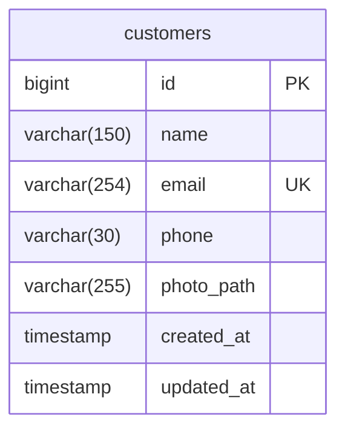

# Modelo relacional — Cadastro de clientes

Banco de dados: PostgreSQL 17.

## Diagrama

## Dicionário de dados

| Campo      | Tipo PostgreSQL               | Permite NULL | Descrição                                             |
| ---------- | ----------------------------- | ------------ | ----------------------------------------------------- |
| id         | BIGINT                        | Não          | Chave primária, gerada automaticamente por sequência. |
| name       | VARCHAR(150)                  | Não          | Nome do cliente.                                      |
| email      | VARCHAR(254)                  | Não          | E-mail único por cliente.                             |
| phone      | VARCHAR(30)                   | Não          | Telefone armazenado como texto.                       |
| photo_path | VARCHAR(255)                  | Não          | Caminho relativo da foto no armazenamento local.      |
| created_at | TIMESTAMP(0) sem fuso horário | Sim          | Data de criação, preenchida pelo Eloquent.            |
| updated_at | TIMESTAMP(0) sem fuso horário | Sim          | Data da última alteração, preenchida pelo Eloquent.   |

## Regras e decisões

- O e-mail é normalizado para minúsculas pela aplicação antes da validação
  e da persistência. O banco também possui uma restrição UNIQUE nesse campo.
- O telefone é texto para preservar prefixos, zeros e formatação.
- A foto fica no servidor local; o banco armazena somente seu caminho relativo.
- A foto é obrigatória no cadastro. Na edição, pode ser mantida ou substituída.
- Os timestamps permitem NULL no esquema criado pela migration, mas são
  preenchidos automaticamente pelo Eloquent nas operações da aplicação.
- O cadastro de clientes não possui relacionamentos com outras entidades.
  As tabelas internas criadas pelo Laravel não estão representadas neste diagrama.
